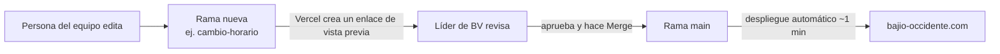

# Guía para modificar el sitio BAJÍO-OCCIDENTE 2030

Sitio público: **https://bajio-occidente.com**
Repositorio: **https://github.com/sebrdz-dev/bajio-occidente-2030**

## Regla principal

**Todo cambio guardado en la rama `main` se publica en bajio-occidente.com en aproximadamente 1 minuto** (Vercel lo despliega de forma automática).

Por eso, **nadie edita `main` directamente**. Cada cambio se trabaja en una rama nueva, se revisa en un enlace de vista previa y **un líder de BV lo aprueba** antes de publicarse.

## 1. Obtener acceso

Pide a la persona administradora del repositorio que te agregue como colaborador en **GitHub → Settings → Collaborators → Add people**. Necesitas una cuenta de GitHub. No necesitas acceso a Vercel.

## 2. Hacer un cambio

Elige el método según el tipo de cambio:

| Método | Úsalo para | Pasos |
|---|---|---|
| **Sitio web de GitHub** | Cambios pequeños de texto: horario, nombres de ponentes, fechas | Abre `index.html` → ícono de lápiz → edita → **Commit changes** → elige **Create a new branch and start a pull request** |
| **Claude Code** | La mayoría de los cambios, incluidas secciones nuevas | Abre una sesión nueva con este repositorio seleccionado → describe el cambio en lenguaje sencillo → pide que lo suba en una rama nueva y abra un pull request |
| **Editor local (VS Code)** | Personas con experiencia técnica | `git clone` → crea una rama → edita → `git push` → abre un pull request |

Nombra la rama con lo que cambia, por ejemplo `cambio-horario` o `seccion-ods`.

## 3. Revisar la vista previa

Al abrir el pull request, Vercel publica un **enlace de vista previa** en los comentarios del pull request. El sitio público **no cambia** todavía.

Antes de pedir aprobación, revisa en la vista previa, en computadora y en móvil:

- [ ] El texto nuevo es correcto y no tiene errores.
- [ ] Las imágenes y los logotipos cargan.
- [ ] Funcionan los botones: **Confirmar asistencia** (Luma), **Cómo llegar**, **Guardar la fecha** y **Ampliar cartel**.
- [ ] La página no se desplaza hacia los lados en el móvil.

## 4. Aprobar y publicar

1. Un **líder de BV** abre la vista previa y revisa el cambio.
2. Si es correcto, aprueba el pull request y hace clic en **Merge**.
3. El cambio aparece en bajio-occidente.com en aproximadamente 1 minuto. Si no lo ves, recarga la página sin caché (Ctrl+Shift+R o Cmd+Shift+R).

Los cambios con contenido financiero, legal o institucional (por ejemplo, compromisos con socios o datos de la alianza) requieren además la revisión de la persona responsable de esa área.

## Dónde está cada cosa

| Qué quieres cambiar | Dónde |
|---|---|
| Textos, secciones, programa, preguntas frecuentes | `index.html` |
| Enlace de registro (Luma) | `index.html`, busca `luma.com` |
| Imágenes y logotipos | Carpeta `assets/`. Reemplaza el archivo **con el mismo nombre** |
| Imagen al compartir en redes | `assets/flyer-oficial.png` |

## Qué no hacer

- No edites ni subas cambios directo a `main`.
- No cambies los nombres de los archivos de `assets/` sin actualizar `index.html`.
- No publiques datos confidenciales de portafolio, socios, pipeline ni datos personales.
- No cambies la configuración del dominio en GoDaddy ni en Vercel sin avisar a la persona administradora.

## Si algo sale mal

Si un cambio publicado rompe el sitio, la persona administradora puede volver a la versión anterior en **Vercel → Deployments → versión anterior → Promote to Production** (inmediato), o revertir el pull request en GitHub con el botón **Revert**.
